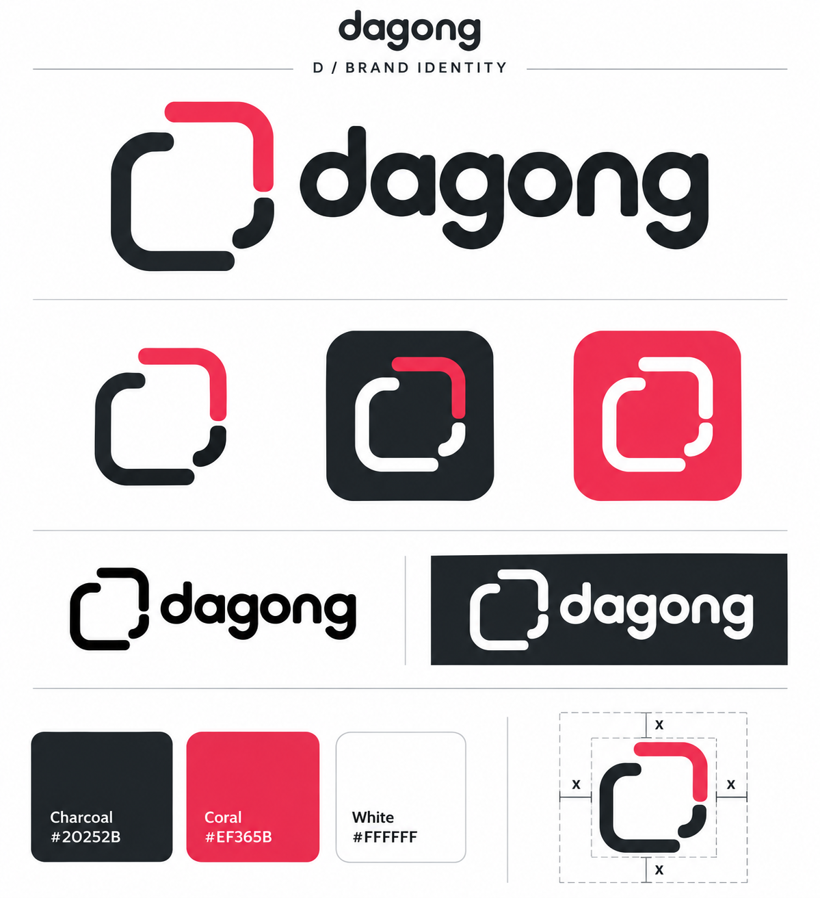

# 다공 공통 브랜드 가이드 — D

2026-11-17 선택한 D2를 D안으로 확정했습니다. 맛다공·여다공을 운영하는 상위 브랜드이며, 개별 서비스의 기존 아이콘과 로고는 별도로 유지합니다.

## 브랜드의 역할

다공은 두 서비스를 총괄하는 회사·공통 계정의 이미지입니다. 맛집과 여행 소품을 합친 아이콘이나 캐릭터 대신, 깔끔하고 세련된 프레임 심볼과 `dagong` 워드마크를 사용합니다. 엇갈린 둥근 프레임의 구조를 유지하며, 한글 ‘다’나 영문 DG를 억지로 끼워 넣지 않습니다.

이 폴더를 다공 D안의 유일한 기준 위치로 사용합니다. 맛다공 저장소의 `frontend/public/assets/brand/`는 개별 서비스 브랜드이므로 서로 덮어쓰지 않습니다.

## 파일과 배경별 사용

| 파일                                             | 용도                                            |
| ------------------------------------------------ | ----------------------------------------------- |
| [brand-logo.png](brand-logo.png)                 | 밝은 배경용 가로 로고, 투명 PNG                 |
| [brand-logo-inverse.png](brand-logo-inverse.png) | 어두운 배경용 가로 로고, 투명 PNG               |
| [brand-symbol.png](brand-symbol.png)             | 독립 심볼, 투명 PNG. 밝은 배경에 사용           |
| [app-icon.png](app-icon.png)                     | 공통 계정용 아이콘 원본, 차콜 배경              |
| [app-icon-upload.png](app-icon-upload.png)       | 250KB 제한 업로드용, 512×512 PNG, 203,000바이트 |
| [brand-guide.png](brand-guide.png)               | 전체 브랜드 구성과 색상·여백 참고               |

## 색상과 형태

기준 색상은 차콜 `#20252B`, 코랄 `#EF365B`, 흰색 `#FFFFFF`입니다. 심볼은 엇갈린 둥근 프레임이며 특정 글자를 억지로 표현하지 않습니다. 주변 여백은 선 두께 이상을 확보하고, 비율을 늘이거나 그림자를 추가하지 않습니다.

- 코랄은 상단 오른쪽 프레임의 강조색으로 사용합니다. 다른 조각에 임의로 섞거나 그라데이션을 추가하지 않습니다.
- 가로 로고의 심볼과 워드마크 간격·크기 비율을 유지합니다. 심볼의 끊어진 구간을 연결하거나 위치를 바꾸지 않습니다.
- 이미지 전체를 비율대로 축소합니다. 내용만 잘라내거나, 가로·세로를 따로 늘이거나, 로고 위에 글자를 겹치지 않습니다.
- 반전 로고는 어두운 배경에 놓는 자산입니다. 어두운 앱 테마를 도입한다는 의미는 아닙니다.
- 실제 화면의 작은 크기에서도 심볼의 틈과 코랄 구간이 구분되는지 확인합니다.

## 개발과 외부 콘솔 업로드

Vite 화면에서 참조할 때는 기존 방식처럼 `import.meta.env.BASE_URL`에 `assets/brand/파일명`을 붙입니다. 파일을 다른 곳에 복제하거나 생성 당시의 로컬 절대 경로를 코드에 넣지 않습니다. 가이드 이미지를 잘라서 쓰지 말고 위 개별 파일을 사용합니다.

공통 다공 앱의 외부 콘솔에 아이콘을 등록할 때는 `app-icon-upload.png`를 선택합니다. 이 파일은 투명하지 않은 정사각형이며 플랫폼이 모서리를 처리할 수 있도록 배경을 채웠습니다. 250KB를 250,000바이트로 보더라도 제한 안에 들어갑니다. 원본 `app-icon.png`는 용량 제한이 있는 업로드에 그대로 사용하지 않습니다.

기존 저장소 루트의 `assets/kakao-developers-app-icon.png`는 이전 맛다공 이미지입니다. 공통 다공 아이콘을 등록할 때 이 파일을 고르지 않습니다. 외부 콘솔의 표시 이미지 등록과 OAuth 설정 변경은 별도 작업이며, 이 자산 정리로 로그인 흐름·토큰·보안 설정은 바뀌지 않습니다.

자산을 교체할 때는 이 표의 형식·용량, README의 적용 상태, 실제 사용 경로를 함께 확인합니다. 업로드용 PNG는 다시 만든 뒤 파일 크기가 250,000바이트 이하인지 확인합니다.

## 원본 형식과 적용 상태

현재 파일은 이미지 생성 도구로 제작한 래스터 자산입니다. 가이드는 배치 참고이며, 실제 사용할 때는 개별 파일을 사용합니다. 인쇄·대형 제작을 위한 정밀 벡터 원본은 포함하지 않습니다. 생성 요청의 핵심은 선택한 D2의 구조와 워드마크를 유지하고, 밝은 배경·어두운 배경용 로고와 독립 심볼·아이콘으로 정리하는 것입니다.

로그인 화면에는 적용했고, 외부 개발자 콘솔에는 아직 등록하지 않았습니다.

2026-11-24 로그인 화면 위쪽(`DagongIntro.tsx`)에 `brand-logo.png`를 적용했습니다. 적용 범위는 [저장소 안내](../../../../README.md)의 적용 상태 절에 적습니다.
